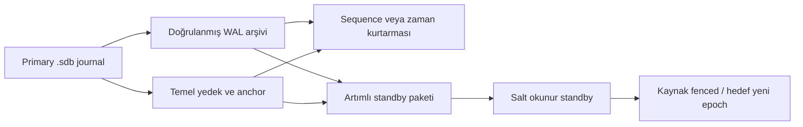

# Açık kaynak motor yöntemlerinin SDBASE'e uyarlanması

Bu belge **0.7.0 / schema v4 temel sürümünün tarihsel raporudur**. Güncel sürekli ağ çoğaltma, otomatik servis devri, sıralı disk indeksi ve online checkpoint çalışması [0.8.0 raporundadır](maturity_080.md). Radyo domain modelinin yanında depolama, kurtarma, eşzamanlı okuma ve işletim katmanlarına gerçek kod eklenmiştir. `.sdb` bağımsız motor biçimidir; SQL veya SQLite/PostgreSQL sunucusu kullanılmaz. Diğer kaynak klasörleri değiştirilmemiştir.

## Kaynaklar ve karşılıkları

| İncelenen yöntem | Yerel birincil kaynak | SDBASE karşılığı | Sınır |
|---|---|---|---|
| Bir commit görüntüsünden okuma | PostgreSQL `snapmgr.c`; SQLite `wal.c`, isolation yaklaşımı | `ReadSnapshot`, katalog arama ve detail API'sinde tutarlı yetki/veri okuması | Bellekte seçilen kayıt haritaları ve indeks üyelikleri kopyalanır; disk tuple MVCC, VACUUM veya paralel writer yok. |
| İndeks seçim ve sorgu işi | PostgreSQL `indxpath.c`; SQLite `where.c` | Hash indeks kesişimi, uygun bileşik prefix/aralık, sıralı keyset, explain ve iş bütçesi | Genel SQL optimizer, disk B-tree/GIN, maliyet istatistikleri ve join optimizer yok. Nullable indeksin örtmediği satırları düşüren plan seçilmez. |
| Checkpoint sonrası kurtarma günlüğü | PostgreSQL WAL arşiv/recovery; SQLite journal/backup | Hash zincirli `.sdb.wal`, işlem ve maintenance bariyeri, temel yedek anchor, medya/soğuk dosya güvencesi | Commit başına dosya/inode ve doğrulama maliyeti; otomatik arşiv GC/sıkıştırma yok. |
| Kesin noktaya geri dönüş | PostgreSQL recovery target mantığı | Temel yedek + WAL'den sequence veya effective UTC zamanına gerçek PITR | Zaman kaynağının gerilemesi ayrıca raporlanır; arşivin kanıtlamadığı ileri hedef reddedilir. Yeni bağımsız kimlik ve credential üretilir. |
| Standby / timeline / kaynak kimliği | PostgreSQL `walreceiver.c`, `xlogrecovery.c`; SQLite `backup.c` | Doğrulanmış fiziksel standby, artımlı paket, sıralama/hash, pending replay, kontrollü devir | Elle başlatılan asenkron aktarım. Erişilebilir eski primary önce fenced olur; otomatik seçim, quorum, senkron uzak commit ve zorla promotion yok. |
| Sınırlı kilit bekleme ve izleme | PostgreSQL `proc.c`, `lock.c` içindeki bekleme/ölçüm yaklaşımı | Süreli thread/flock, rol/epoch yazma kapısı, sınırlı süreç ölçümleri | PostgreSQL lock manager uygulanmadı; yazmalar yine tek store kilidiyle sıralanır. |
| Bağlantı kaynaklarını sınırlama | Python standart HTTP/SSL arabirimleri üzerinde bağımsız uygulama | Sınırlı HTTP worker/socket kabulü, keep-alive ve endpoint bağlantı havuzu | Veritabanı backend process havuzu veya PostgreSQL connection pooler değildir. |
| Operatör bütünlük taraması | SDBASE'in mevcut checksum/reference/media/retention sözleşmeleri | Onarmayan, byte/record bütçeli scrub; eksik taramayı `incomplete` bildirir | Sessiz tamir veya bütçe bittiğinde yeşil sonuç yok; bağımsız medya ve ses cihazı ölçümü ayrı. |

Yerel PostgreSQL kaynak sürümü **20devel**, commit `b69356cd789fe963447177a0077c12c6c322c203`; yerel SQLite **3.54.0**, commit `519e4c23a58ad3fa78926b9df31c03ad55b73d42`. PostgreSQL `COPYRIGHT` izinli PostgreSQL lisansını, SQLite public domain bildirimini taşır. Özellikler burada bağımsız Python modülleri olarak yazılmıştır; bu motorlardan birebir C kaynak kodu veya GPL kodu yeni modüllere taşınmamıştır. Kapalı radyo ürünleri için erişilmeyen depolama kaynak kodu uyarlanmış gibi gösterilmez; onların desteklenen veri formatları önceki adaptör matrisinde kalır.

Birincil kavram belgeleri: [PostgreSQL MVCC](https://www.postgresql.org/docs/current/mvcc.html), [WAL arşivi/PITR](https://www.postgresql.org/docs/current/continuous-archiving.html), [standby](https://www.postgresql.org/docs/current/warm-standby.html), [izleme](https://www.postgresql.org/docs/current/monitoring-stats.html), [SQLite isolation](https://www.sqlite.org/isolation.html), [query planner](https://www.sqlite.org/queryplanner.html), [online backup](https://www.sqlite.org/backup.html). SDBASE'in davranışı ilgili kendi sözleşmesinde ve kabul aracında tanımlanır; bu bağlantılar ürünlerin birebir uyum garantisi değildir.

## İşletim akışı

Başlamak için [okuma/sorgu](snapshot_queries.md), [WAL/PITR](wal_recovery.md), [replika](replication.md), [HTTP/izleme](engine_operations.md), [integrity](integrity.md) ve [göç](schema_migration.md) belgelerini kullanın. Schema v1/v2/v3 dosyaları kaynak yerinde değiştirilmeden v4'e kopya göçü ister. WAL ve standby özelliği yeni kurulumda kendiliğinden açılmaz.

## Kanıt ve kapasite sınırı

Tekrarlanabilir kabul araçları yalnız kendi geçici store'larını kullanır; bozuk arşiv/medya, eksik sıra, yarım yazma ve gerçek child process kapanması senaryoları üretir. Kaynak klasörüne örnek `.sdb`, medya fixture'ı veya geçici regression dosyası bırakılmaz. Küçük kabul fixture'ının süresi büyük üretim verisinin RTO/RPO ölçümü sayılmaz.

2026-10-01 temel 0.7.0 kodu üzerinde **159/159 kontrol geçti**:

| Kabul aracı | Kontrol | Kapsam |
|---|---:|---|
| `tools/recovery_acceptance.py` | 35 | WAL/PITR, gerçek süreç kapanması, kesin sıra/zaman, kaynak kaybı, medya/soğuk geçmiş. |
| `tools/replication_acceptance.py` | 35 | Standby, delta/gap/tamper, fiziksel kopyalama/replay/devir sırasında süreç kapanması, eski writer ve credential fence. |
| `tools/query_integrity_acceptance.py` | 33 | Tutarlı eşzamanlı görüntü, query/keyset, nullable indeks, yetki, gerçek bozuk veri/medya/arşiv ve bütçeli scrub. |
| `tools/engine_acceptance.py` | 19 | HTTP havuzu/kabul sınırı/gövde çerçevesi, committed-unack sonucu, gerçek süreç kilidi, v1/v2/v3→v4. |
| `tools/acceptance.py --offline-seconds 0` | 37 | Ayrı merkez/uç HTTP süreçlerinde cue/transition/makro/stream/event, iki sanal hizmet günü ve kaynak silindikten sonra backup-only PCM. |

Ek 16 CLI çağrısı init→WAL→yedek→PITR→standby→paket→catchup→promotion→query/explain→metrics/integrity zincirinde başarılı oldu. Yönetici integrity HTTP yolu temiz sonucu, byte bütçesinde `incomplete` sonucunu ve OpenAPI alanlarını verdi. Son playout koşusu 8,17 saniye sürdü; gerçek günler süren offline soak veya fiziksel ikinci makine değildir. Önceki 60 saniyelik outage kanıtı 0.6.0 belgesinde ayrı kalır.

Merkez güncel kayıtları ve indeksleri hâlâ RAM'de tutar. Snapshot kopyalama maliyeti seçilen koleksiyon ve indeks üyeliği sayısıyla büyür; çok sayıda eşzamanlı büyük görünüm RAM tüketir. Önceki 250.000 içerik/240.000 operasyon kaydı ölçümü 0.6.0'a aittir; 0.7.0'ın yeni snapshot, WAL ve replika maliyetine aynı kapasite sonucu aktarılmaz. Saha yükü, RAM/inode/disk kapasitesi ve arşiv aktarım sıklığı ayrıca ölçülmelidir.

Bu sürümde domain ve işletim özellikleri genişletilmiştir. Terabayt ölçeği, PostgreSQL'in bütün transaction/indeks özellikleri, otomatik çok makine failover, fiziksel ikinci makine veya kesintisiz donanım ses çıkışı kanıtı yoktur.
