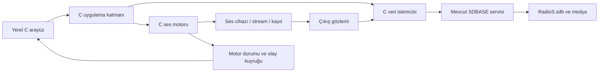

# 1. aşama — işlev haritası

Tarih: 2026-10-06. Proje: `kaynak kodlar/RadioS/`. Bu dosya uygulama geliştirmesinin kapsamını ve işlevlerin sorumlularını tanımlar; çalışır programın hazır olduğunu belirtmez.

## Kesinleşen sınırlar

- Ürün yerel **C masaüstü uygulamasıdır**. Pencere, ekranlar, kontroller, uygulama iş mantığı ve gerçek ses motoru C ile geliştirilecektir.
- HTML/CSS/JavaScript yalnızca görünüm, yerleşim, renk, yazı, ekran ve kontrol referansıdır. WebView, tarayıcı arayüzü veya JavaScript yayın altyapısı bu mimarinin parçası değildir.
- Tasarımda gösterilen alanlar işlev haritasına alınır; tasarımdaki örnek algoritma, veri ve durum değişimi gerçek altyapı veya uygulanmış işlev sayılmaz.
- Mevcut SDBASE Python motorunun gerçek iş akışları veri sözleşmesi olarak kullanılır. C uygulamasının SDBASE ile HTTP/JSON konuşması süreçler arası veri bağlantısıdır; arayüz C masaüstü bileşenlerinde çizilir.
- Yeni kaynaklar, geliştirme belgeleri, araçlar ve ileride eklenecek veritabanı/medya/yapılandırma dosyaları RadioS altında tutulur. 1. aşamada dışarıdaki tasarım ve SDBASE referans kaynakları değiştirilmedi veya taşınmadı; 2. aşamada proje içi kopyaları oluşturuldu.
- Tasarımdaki örnek playlist, reklam ve kullanıcılar gerçek kayıt olarak açılışta yüklenmez. Tarayıcı depolamasından veri göçü zorunlu ürün kapsamı değildir.

## Kaynaklardan çıkarılan envanter

Envanter, tasarım HTML'inin ayrıştırılması ve SDBASE'in kendi `openapi_document()` işlevi ile `ACTIONS` listesinin okunmasıyla üretildi. Veritabanı açılmadı ve yayın çalıştırılmadı. Kaynak dosyaların SHA-256 özetleri [envanterde](islev-envanteri.json) saklanır.

| Tasarım alanı | Statik kontrol örneği sayısı | İşlev eşleme belgesi |
|---|---:|---|
| Yayın | 66 | [Yayın/DJ](yayin-dj-islevleri.md) |
| Playlist | 48 | [Playlist/otomasyon](playlist-otomasyon-islevleri.md) |
| Otomasyon | 46 | [Playlist/otomasyon](playlist-otomasyon-islevleri.md) |
| DJ | 13 | [Yayın/DJ](yayin-dj-islevleri.md) |
| Acil | 132 | [Acil/reklam/teknik](acil-reklam-teknik-islevleri.md) |
| Reklam | 39 | [Acil/reklam/teknik](acil-reklam-teknik-islevleri.md) |
| Teknik yönetim | 70 | [Acil/reklam/teknik](acil-reklam-teknik-islevleri.md) |
| Ortak üst alanlar, gezinme ve ek pencereler | 138 | [Yayın/DJ](yayin-dj-islevleri.md), [Acil/reklam/teknik](acil-reklam-teknik-islevleri.md) |
| **Toplam** | **552** | **7 profil ve ortak alanlar** |

Kontrol örneği sayısı benzersiz işlev sayısı değildir. Girdi, buton, seçim, sekme, açılır ayrıntı, bağlantı, canvas ve uygun erişilebilirlik rolü taşıyan elemanlar sayılmıştır; görünmeyen ek pencereler dahildir. JavaScript ile çizilen deck, mixer, efekt ve pad satırları bu statik sayıya dahil değildir; eşleme belgelerinde işlev grupları olarak ele alınır. 15 HTML referans dosyası ve index'in bağladığı 25 tasarım scripti envanterde görünür; fragment kontrolleri toplama tekrar eklenmez. Tasarımda 51 kontrolün devre dışı olması gerçek ürün yetkisi veya uygulanma durumu değildir.

Mevcut SDBASE sözleşmesinde **160 workflow, 210 farklı HTTP yolu, 215 yöntem+yol işlemi** bulunuyor. Aynı yolun GET ve POST biçimleri ayrı işlemlerdir. Kaynak durumu 0.8.1'dir. OpenAPI bazı doğrudan istek gövdelerini genel nesne olarak tanımlar; C istemci geliştirilirken dispatcher ve servis doğrulamaları da kullanılacaktır. Bu sayılar RadioS ekranlarının zaten bağlandığı anlamına gelmez.

## İşlevin sahibini belirleme

Eşleme tablolarındaki C görevleri önerilen bileşenlerdir; henüz oluşturulmuş `.c` dosyaları değildir. Sorumluluklar aşağıdaki gibi ayrılır:

| Bileşen | Sorumluluğu | Temel çıktı |
|---|---|---|
| C arayüz | Yerleşim, çizim, seçim, klavye, sürükleme, form ve erişilebilirlik | Kullanıcı niyeti; motor ve DB durumunun gösterimi |
| C uygulama katmanı | Alan doğrulama, kalıcı kimlik eşleme, komut sıralama ve iş akışı koordinasyonu | Onaylanmış veri isteği veya motor komutu |
| C SDBASE istemcisi | Bearer kimliği, HTTP/JSON, okuma/yazma, revision ve yeniden deneme | Başarı, yetki reddi, çakışma veya bağlantı hatası |
| SDBASE | Kalıcı katalog, medya kimliği, plan, reklam, hak, yetki ve olay kayıtları | UUID, `_rev`, tutarlı `sequence` ve değişmez plan/marker sözleşmesi |
| C medya katmanı | Dosya inceleme, codec çözümleme, waveform önbelleği ve teknik ölçüm | Teknik medya bilgisi ve hazırlanmış PCM |
| C ses motoru | Deck, örnek saati, kuyruk, miks, DSP, cue/fade/segue, canlı giriş | Gerçek PCM akışı ve yürütme durumu |
| C cihaz/yönlendirme | Gerçek aygıt keşfi, ana çıkış, CUE, monitor ve geri dönüş | Seçilen cihaz/kanalda ses |
| C yayın/kayıt adaptörleri | Encoder/stream, kayıt dosyası, metadata ve cihaz tetikleyicileri | Fiziksel veya ağ çıkışı ve sonuç |
| C gözlem/izleme | Ses seviyesi, sessizlik, bağlantı, disk, aygıt ve motor sağlığı | Zaman damgalı ölçüm, teşhis ve bağımsız çıkış gözlemi |

UI iş parçacığına ağ, dosya veya ses çözümleme işi yüklenmez. Ses callback'i veritabanı, HTTP, dosya indirme veya GUI kilidi beklemez. İletişim sınırlandırılmış komut/durum kuyruklarından yapılır. GUI kapanışı, veritabanı bağlantı kesintisi ve ses motoru durdurma ayrı yaşam döngüsü olaylarıdır.

## Ortak veri ve komut sözleşmesi

| Konu | Uygulama kuralı | Kabul senaryosu |
|---|---|---|
| Kimlik | Başlık veya tasarım sıra numarası yerine `station_id`, `endpoint_id`, `output_id`, item/version/plan/revision UUID'leri kullanılır. | Aynı isimli iki içerik düzenlenirken doğru UUID değişir. |
| Çıkış seçimi | Tasarımdaki stüdyo/internet/karasal adları kullanıcıya gösterilir; gerçek bağlantı kayıtlı istasyon/uç/çıkış kimliğiyle kurulur. | Adı aynı olan iki çıkıştan yalnız seçilen uç/kanal değişir. |
| Sürüm | Planın `revision_no` numarası ile belgenin `_rev` değeri ayrı tutulur. Güncelleme önkoşulları ilgili gerçek `_rev` ile gönderilir. | Başka kullanıcı düzenlemesinde 409 alınır; yeni veri okunup değişiklik uzlaştırılır. |
| Taslak ve onay | Düzenleme, yayımlama, onay, dağıtım ve motor kabulü ayrı adımlardır. Onaylı veri yeni taslak açılmadan değiştirilemez. | Onaylı plan düzenleme isteği yeni taslak gerektirir; çalan revizyon değişmez. |
| Tekrarlanabilir yazma | Destekleyen API'lerde aynı işlemin yeniden denemesi aynı `idempotency_key`, hash ve revision önkoşuluyla yapılır. | Bağlantı yanıtı kaybolduğunda ikinci istek çift playlist girdisi/reklam rezervasyonu üretmez. |
| Medya | Item, version ve media_file ayrılır. Yayın öncesi onay, teknik doğrulama, SHA ve uç dosyası koşulları denetlenir. | Aynı dosya adında değiştirilmiş ses hash uyuşmazlığında hazır görünmez. |
| Marker | Cue/fade/segue değerleri milisaniye ve medya sürümüyle bağlanır; onaylı planın frozen marker seti yürütülür. | Editördeki yeni taslak işaretler çalan eski onaylı planı değiştirmez. |
| Zaman | Kalıcı anlar zaman dilimli ISO biçiminde; takvim istasyon zaman dilimiyle; ses ilerlemesi örnek/monotonik saatle hesaplanır. | Duvar saati değişimi ses konumunu geriye taşımaz; gece yarısı ve DST takvim testleri geçer. |
| Birim | DB alanının saniye/ms/örnek beklentisi açıkça çevrilir; değerler yalnız etiketlerine göre kopyalanmaz. | 250 ms fade, 250 saniye olarak uygulanmaz. |
| Komut | Kullanıcı niyeti, doğrulama, kabul, yürütme sonucu ve fiziksel gözlem ayrı durumlar olarak tutulur. | Oynat butonu motor reddinde 'çalıyor' göstermeden neden sunar. |
| Süreli komut | Uç/motor dönemi, hedef revizyon ve geçerlilik penceresi denetlenir; eski komut yeniden bağlanmada otomatik çalıştırılmaz. | Kesinti sırasında süresi dolan başlat komutu bağlantı dönüşünde yayını başlatmaz. |
| Yetki | Görsel rol adı yerine gerçek sunucu izinleri uygulanır; C motoru komutları da aynı yetki kararına tabi olur. | Sadece izleme yetkisi olan kullanıcı doğrudan komut gönderince de ses değiştiremez. |
| Sağlık | Sağlıklı süreç/HTTP yanıtı ses çıkışının kanıtı değildir; bilinmeyen/eski ölçüm ayrı gösterilir. | Cihaz söküldüğünde DB sağlıklı kalırken çıkış arızası görünür. |
| Kanıt | Motor olayları, harici çıkış gözlemleri ve reklama özgü içerik kanıtı ayrı saklanır. | Ses seviyesi algısı tek başına belirli spotun teslimi olarak raporlanmaz. |

SDBASE alan türleri tasarım etiketleriyle birebir varsayılmaz. Örneğin tasarım `advert` etiketi katalogda `advertisement`, `programme` etiketi katalogda `program` olabilir; plan olay türü ayrıca belirlenir. Dönüşüm her form için gerçek servis imzası ve şema üzerinden yazılır.

## Hata ve bağlantı davranışı

| Sonuç | C uygulamasının davranışı |
|---|---|
| 403 / geçersiz kimlik | İzin/kimlik hatası göster; başarısız işlemi tamamlanmış sayma. Gizli değerleri loglama. |
| 404 | Eksik veya kapsam dışı kaydı göster; başlıkla tahmin ederek başka nesneye yazma. |
| 409 | Güncel `_rev`/snapshot oku; kullanıcının değişikliğini koruyup uzlaştırma sun. Önizleme hash'i değiştiyse yeniden oluştur. |
| 422 | Alan/kural hatasını ilgili formda göster; yerel taslak korunur. |
| 429 | `Retry-After` süresini ve sınırlı tekrar politikasını uygula; UI donmaz. |
| 503, `committed=true` | İşlem sonucu önce okunur; kör yeniden yazma yapılmaz. |
| Diğer 503 / timeout | Veri kaydı için başarısız/bekleyen durum göster; doğrulanmış uç medya ve geçerli offline yetkisi varsa motorun izinli planı sürdürme koşulları ayrı denetlenir. |
| Aygıt/codec hatası | Hangi dosya/çıkışın başarısız olduğu görünür; fallback ancak onaylı yapılandırmayla yürür. |

Kaynak kanıtı: `database/SDBASE/src/sdbase/read_api.py`, `http_server.py`, `workflow_api.py`, `identity.py`, `playback_markers.py`, `playout.py` ve `endpoint.py`. Ayrıntılı alan sözleşmeleri [OpenAPI çıktısında](sdbase-openapi.json), workflow imzaları [envanterde](islev-envanteri.json) bulunur.

## Uygulanacak eksikler ve sınırlar

| Eksik | Geliştirme kararı / aşama |
|---|---|
| C pencere, widget, tema, ölçü, çizim ve etkileşim sistemi | Aşama 3–4; native C GUI. Toolkit/codec/cihaz kütüphanesi seçimi burada yapılmış değildir. |
| Gerçek cihaz ses motoru, çoklu deck, DSP ve routing | Aşama 7–9. SDBASE `audio_playout.py:1` yalnız offline WAV dosyası üreten yürütücüdür. |
| Tasarım ile DB arasında birebir olmayan playlist/otomasyon işlemleri | Aşama 6 ve 10; eksik sözleşmeler işlev tablolarında belirtilir, ham koleksiyon yazımıyla atlanmaz. |
| Donanım MIDI/GPIO, mikrofon, mix-minus, encoder ve kayıt | Aşama 8–9 ve 12–13; veri profili fiziksel yürütücü yerine geçmez. |
| Acil yayın/sessizlik ve fiziksel tek aktif ses çıkışı | Aşama 12–13; DB primary/standby devri ayrıca ses yönlendirme devri gerektirir. |
| Reklam fiyatı/sözleşme ayrıntıları, ek listeleme/düzenleme API'leri | Aşama 6 ve 11; desteklenmeyen alanlar için açık model/API geliştirmesi gerekir. |
| Parola, MFA, kurum kimliği, USB anahtar ve süreli program/deck yetkileri | Aşama 13; mevcut Bearer ve istasyon yetkileri bu özelliklerin tümünü sağlamaz. |
| Dış site/uzak panel bağlantıları | Aşama 12–13'te native programın dış servis bağlantıları olarak ele alınır; ayrı web uygulaması bu planın teslimatı değildir. |
| DB kaynaklarının paketlenmesi ve servis yaşam döngüsü | Kaynaklar aşama 2'de RadioS içine alındı; servis yaşam döngüsü aşama 5–6 ve paketleme aşama 14'te tamamlanacak. |
| Windows taşınabilirliği | Mevcut SDBASE `storage.py:17` ve `endpoint_journal.py:5` POSIX `fcntl` kullanır. İlk geliştirme mevcut Linux ortamında; başka platform kabulü ayrıca çalışılmalıdır. |

## Aşama 1 kabulü

Bu aşama aşağıdaki çıktılar doğrulanınca tamamlanır:

1. Yedi profil ve ortak/dinamik kontrol grupları, kaynak konumlarıyla eşleme belgelerinde yer alır.
2. Her işlev grubu için mevcut gerçek veri API'si veya eksik sözleşme, gereken C işi ve kabul ölçütü belirtilir.
3. Tasarım kaynakları altyapı kabul edilmez; mevcut SDBASE desteği ile önerilen C bileşenleri açıkça ayrılır.
4. Üretilen kontrol/API envanteri referans kaynaklarla yeniden üretildiğinde eşleşir; workflow kaynakları ve API yolları doğrulanır.
5. Programın henüz derlenebilir/çalışır olmadığı ve sonraki aşamaların durumu açıkça kaydedilir.

Son ürün kabulü ayrıca gerçek cihaz ses çıkışı, yeniden başlatma sonrası veri kalıcılığı, çoklu deck/CUE ayrımı, otomasyon, reklam, acil geçiş, kesinti ve uzun süreli yayın testlerini gerektirir. Bunlar bu belge oluşturma aşamasında çalıştırılmış sayılmaz.

## Tamamlanma ve doğrulama kaydı

**Aşama 1, 2026-10-06 tarihinde tamamlandı.** Üç eşleme belgesinde 194 benzersiz tablo kimliği bulunur: Yayın/DJ/ortak alanlarda 81, Playlist/Otomasyon/Program bağlantılarında 57, Acil/Reklam/Teknik alanlarda 56. Bunlar belge satırlarıdır; tekrar kullanılan işlevler bulunduğundan 194 bağımsız geliştirme işi veya yalnız ana ekranda bulunan 194 kontrol anlamına gelmez. İkincil tasarım parçalarının ek ayrıntıları ayrıca işaretlenmiştir.

| Doğrulama | Sonuç |
|---|---|
| `python3 RadioS/tools/islev_envanteri.py --check` | Başarılı; yeniden üretilen envanter ve OpenAPI kayıtlı çıktılarla birebir eşleşti. |
| Referans kaynak özetleri | 165 kaynak dosyasının SHA-256 özeti envanterle eşleşti. |
| Tasarım envanteri | 7 profil, 552 statik kontrol örneği; fragmentler toplamda tekrar sayılmadı. |
| Gerçek veri sözleşmesi | 160 workflow, 210 HTTP yolu ve 215 yöntem+yol işlemi kaynak koddan doğrulandı. |
| İşlev tablosu yapısı | 194 benzersiz grup kimliği, her satırda 5 bilgi sütunu; tekrar veya eksik sütun bulunmadı. |
| Kaynak atıfları | Tam/göreli kaynak yollarıyla verilen 647 dosya:satır atfının dosyası ve satır aralığı doğrulandı. |
| Belgelerdeki açık API yolları | 70 yol/workflow atfı OpenAPI ile karşılaştırıldı; yer tutucu kimlik adları eşdeğer sayıldı, desteklenmeyen yol kalmadı. |
| Belge bağlantıları | 19 yerel dosya bağlantısı çözüldü; eksik hedef bulunmadı. |
| Manuel sözleşme incelemesi | Komut yolu, taslak geçiş bağlamı, playlist üyeliği kaldırma ve ikincil tasarım kapsamı açıklamaları düzeltildi. |

Doğrulama belge, kaynak ve veri sözleşmesi düzeyindedir. C derleme, gerçek ses çıkışı, TTS, stream, cihaz devralması veya canlı DB istek testleri bu aşamada yapılmış değildir. İlgili uygulanmış işlevlerin kabulü 3–14. aşamalarda gerçekleştirilecektir.
